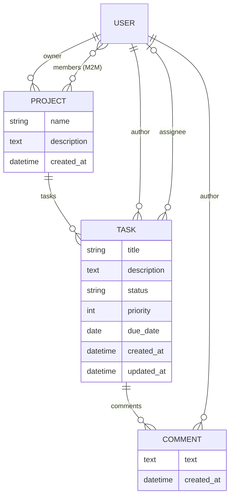
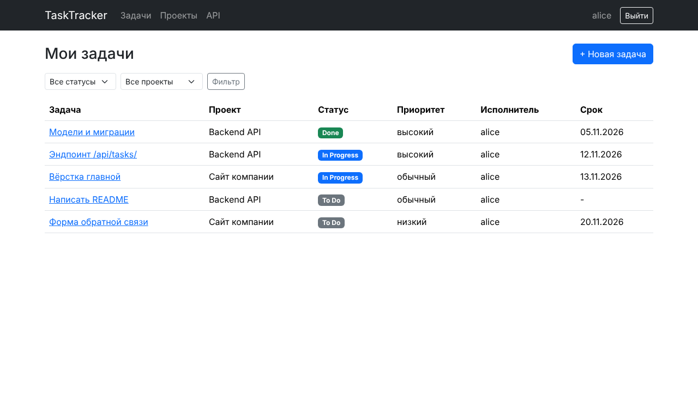
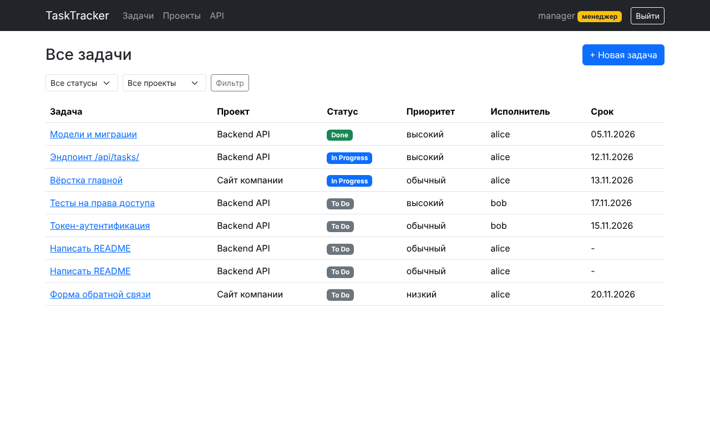
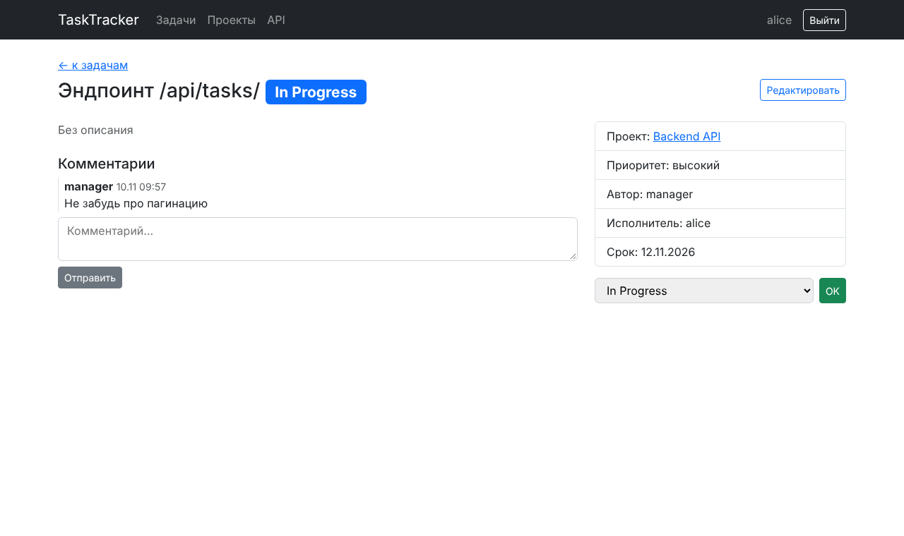
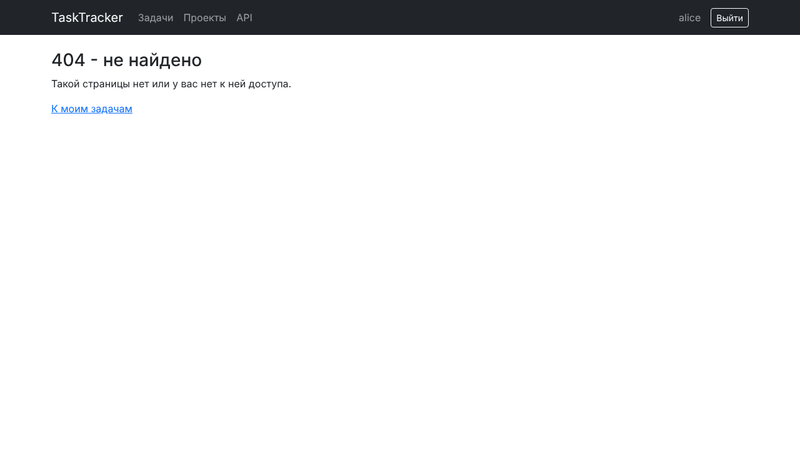
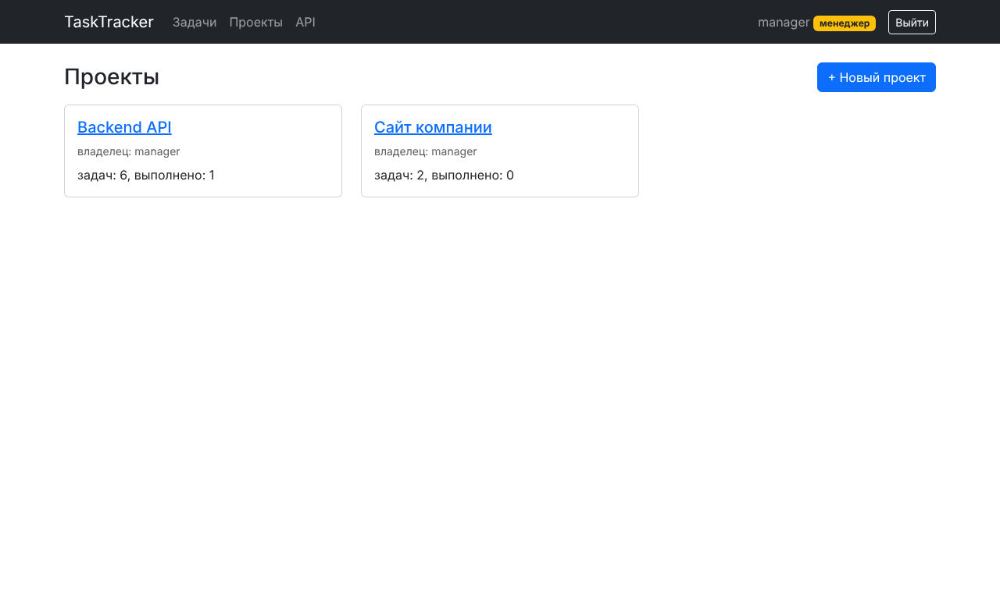
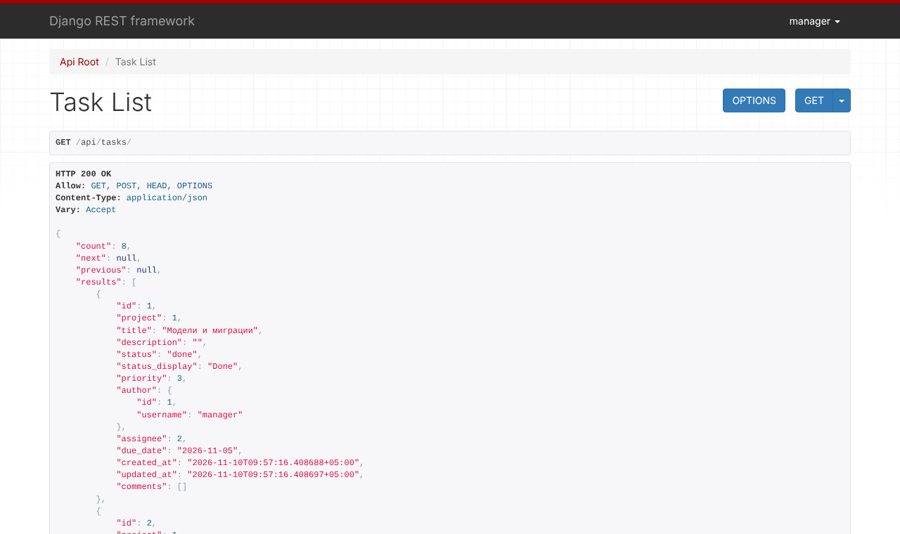

# TaskTracker - трекер задач для команды

Курс «Backend-разработка на Django», задание 2 «Трекер задач для команды» (права доступа и IDOR).

Автор: Дильмухан Дамир, УСВТиПО 26-4. Делал один, поэтому все роли (архитектор, backend, API/тесты, DevOps) на мне.


## Что есть

- регистрация, вход, выход (`accounts`)
- проекты (участники через M2M), задачи со статусами **To Do / In Progress / Done**, приоритетом, сроком и исполнителем, комментарии
- полный CRUD задач на CBV: `ListView`, `DetailView`, `CreateView`, `UpdateView`, `DeleteView`, формы на `ModelForm`
- обычный пользователь видит только свои задачи (где он автор или исполнитель), чужая задача по id отдаёт 404
- роль «Менеджер» (группа с правом `tracker.view_all_tasks`): видит все задачи, создаёт и удаляет проекты, назначает задачи на других
- REST API на DRF (`ModelViewSet` + `DefaultRouter`), токен-аутентификация, Browsable API
- админка с фильтрами, поиском и inline-задачами
- Docker + docker-compose (Django + PostgreSQL), GitHub Actions (ruff, тесты, coverage, `check --deploy`, сборка образа)

## Модели (ER-диаграмма)



## Права доступа

| Действие | Гость | Пользователь | Менеджер |
|---|---|---|---|
| Список задач | -> на логин | только свои (автор/исполнитель) | все |
| Открыть / изменить чужую задачу по id | -> на логин | 404 | да |
| Создать задачу | - | да, только на себя и только в своём проекте | да, на любого участника проекта |
| Удалить задачу | - | только если он автор | да |
| Создать / изменить / удалить проект | - | 403 | да |
| API без токена | 401 | - | - |

Как сделано:

- `LoginRequiredMixin` на всех страницах трекера
- `Task.objects.visible_for(user)` в `tracker/models.py`. Все представления задач берут queryset через него, поэтому чужой id просто не находится и будет 404 (403 подсказал бы, что такая задача есть)
- `PermissionRequiredMixin` (`tracker.add_project`, `change_project`, `delete_project`) для управления проектами, у обычного пользователя 403
- группа «Менеджер» создаётся миграцией `tracker/migrations/0002_manager_group.py`
- в API то же самое: `get_queryset()` фильтрует по пользователю, плюс свои permission-классы `IsManagerOrReadOnly` и `CanEditTask`
- в формах и сериализаторе проверяется, что проект свой, а исполнитель состоит в проекте

## Запуск

Нужны Docker и docker compose.

```bash
cp .env.example .env
docker compose up --build
```

Открыть http://localhost:8000. При `SEED_DEMO=1` создаются демо-данные:

| Логин | Пароль | Роль |
|---|---|---|
| manager | Demo-pass-2026 | Менеджер |
| alice | Demo-pass-2026 | пользователь |
| bob | Demo-pass-2026 | пользователь |

Админка: создать суперпользователя `docker compose exec web python manage.py createsuperuser`, затем http://localhost:8000/admin/.

Без Docker (sqlite):

```bash
python -m venv venv && source venv/bin/activate
pip install -r requirements-dev.txt
cp .env.example .env   # в .env поставить DEBUG=True
python manage.py migrate
python manage.py seed_demo
python manage.py runserver
```

## REST API

| Метод | URL | Что делает |
|---|---|---|
| POST | `/api/auth/token/` | получить токен (`username`, `password`) |
| GET/POST | `/api/tasks/` | список своих задач / создать, фильтр `?status=done` |
| GET/PUT/PATCH/DELETE | `/api/tasks/{id}/` | задача (чужая -> 404) |
| GET/POST | `/api/projects/` | проекты (создавать может только менеджер) |
| GET/PUT/PATCH/DELETE | `/api/projects/{id}/` | проект |

```bash
curl -X POST http://localhost:8000/api/auth/token/ -d "username=alice&password=Demo-pass-2026"
curl -H "Authorization: Token <токен>" http://localhost:8000/api/tasks/
```

Browsable API: войти на сайт и открыть http://localhost:8000/api/.

## Тесты

```bash
python manage.py test            # 51 тест
coverage run manage.py test && coverage report
```

- `tracker/tests/test_models.py` - модели, `visible_for`, права на редактирование
- `tracker/tests/test_forms.py` - валидация форм (срок в прошлом, чужой проект, исполнитель не из проекта)
- `tracker/tests/test_views.py` - CRUD через `Client`, регистрация, фильтры
- `tracker/tests/test_security.py` - IDOR: открыть/изменить/удалить/сменить статус/прокомментировать чужую задачу по id, чужой проект, создание задачи в чужом проекте, 403 на управление проектами
- `tracker/tests/test_api.py` - `APITestCase`: токен, 401 без токена, 404 на чужие задачи, запрет назначать на других

Покрытие 99% (`docs/coverage.txt`).

## Безопасность

- `SECRET_KEY`, `DEBUG`, `ALLOWED_HOSTS`, доступ к БД вынесены в `.env` (`python-decouple`), `.env` в `.gitignore`
- при `DEBUG=False` включаются HSTS, secure-cookie, редирект на HTTPS
- `python manage.py check --deploy` проходит без предупреждений (`docs/check_deploy.txt`, проверяется в CI)
- выход из аккаунта только POST-запросом с CSRF-токеном
- в контейнере приложение работает не от root

Локально в `.env.example` редирект на HTTPS и secure-cookie выключены, иначе по http://localhost не получится войти.

## CI (GitHub Actions)

`.github/workflows/ci.yml`, запускается на push в `main` и на pull request:

1. lint - `ruff check` и `ruff format --check`
2. test - PostgreSQL 16 в `services`, проверка миграций, тесты с coverage (не меньше 70%), `check --deploy`
3. docker - сборка образа

## Структура

```
config/            настройки, корневые urls
accounts/          регистрация (SignUpView, SignUpForm)
tracker/
  models.py        Project, Task, Comment, visible_for()
  views.py         CBV для задач и проектов
  forms.py         TaskForm, ProjectForm, StatusForm, CommentForm
  admin.py
  api/             serializers, views (ViewSet), permissions, urls
  management/commands/seed_demo.py
  tests/
templates/         шаблоны (Bootstrap 5)
Dockerfile, docker-compose.yml, entrypoint.sh
.github/workflows/ci.yml
docs/              скриншоты, отчёты coverage и check --deploy
```

## Скриншоты

| | |
|---|---|
|  Мои задачи (alice) |  Все задачи (менеджер) |
|  Карточка задачи |  alice открывает задачу bob по id -> 404 |
|  Проекты |  Browsable API |
